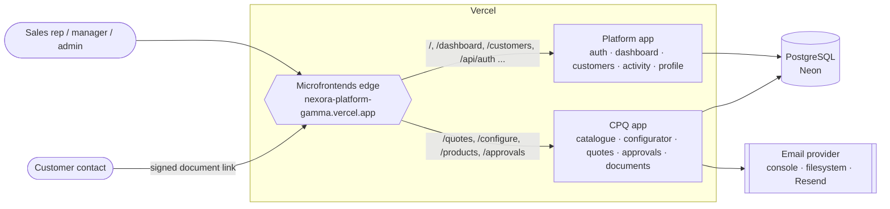
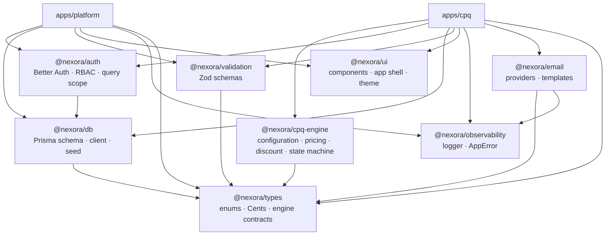
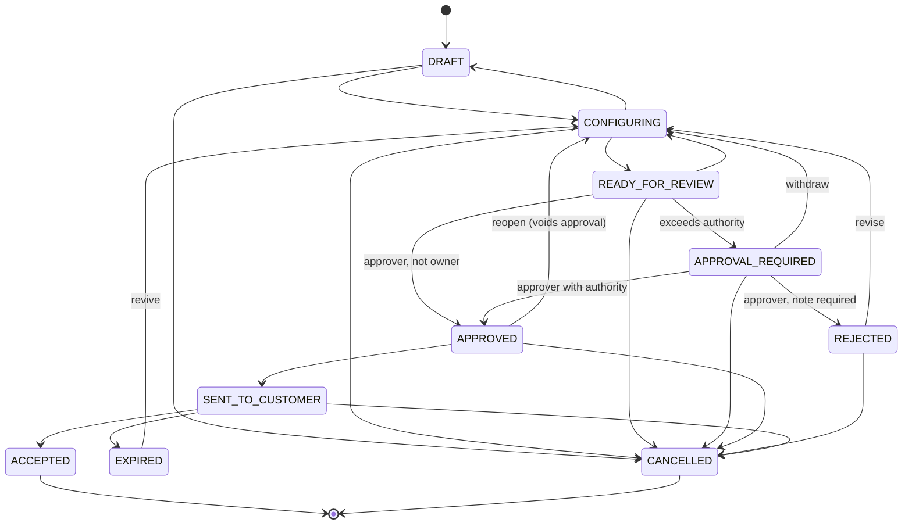

# Architecture

Nexora CPQ is two Next.js applications — **Platform** and **CPQ** — served from
one origin, sharing a set of workspace packages and one PostgreSQL database.
This document is the map; the detail lives in the linked documents.

| Topic | Document |
|---|---|
| How the two zones become one product | [MFE.md](MFE.md) |
| Data model, migrations, seed | [DATABASE.md](DATABASE.md) |
| Rules, pricing, discounts, the state machine | [CPQ-RULES.md](CPQ-RULES.md) |
| Authentication, authorization, threat model | [SECURITY.md](SECURITY.md) |
| Test strategy and how to run each layer | [TESTING.md](TESTING.md) |
| Vercel, environment variables, free-tier limits | [DEPLOYMENT.md](DEPLOYMENT.md) |
| Why things are the way they are | [DECISIONS.md](DECISIONS.md) and [adr/](adr/) |

---

## System context



Both apps are deployed independently (two Vercel projects from one repository,
[ADR-009](adr/ADR-009-one-repository-two-projects.md)). The browser only ever
talks to one origin, so the session cookie issued by Platform is sent to CPQ
without any cross-site configuration.

---

## Packages



The dependency rules that keep this healthy:

- **`@nexora/cpq-engine` imports nothing but `@nexora/types`.** No database, no
  React, no I/O. That is what lets the configurator run the *same* rule and
  pricing code in the browser as a live preview while the server runs it again
  as the authority ([ADR-008](adr/ADR-008-isomorphic-engine.md)).
- **Apps never import each other.** Platform and CPQ share code only through
  packages, and data only through the database ([MFE.md](MFE.md)).
- **Deep imports are lint errors.** Packages are consumed through their declared
  `exports`, so internal files can move without breaking a consumer.
- **`@nexora/db` is server-only.** Its entry point imports `server-only`, so an
  accidental import from a client component fails the build instead of shipping
  a database client to the browser.

---

## Request lifecycle of a mutation

Every write in the application follows the same shape. Using "save a quote
configuration" as the example:

```mermaid
sequenceDiagram
  autonumber
  participant B as Browser (configurator)
  participant A as Server action
  participant S as Quote service
  participant E as cpq-engine
  participant D as PostgreSQL
  participant M as Email provider

  B->>B: evaluate rules + price locally (preview only)
  B->>A: saveConfiguration({ quoteId, selections, term, requestedDiscountBps })
  A->>A: authenticate (session cookie → Actor)
  A->>S: saveConfiguration(actor, input)
  S->>S: Zod parse (unknown keys such as prices are stripped)
  S->>D: load quote; check row-level scope and edit permission
  S->>D: load catalogue + active rules
  S->>E: evaluateConfiguration → evaluateDiscount → calculatePrice
  S->>D: BEGIN; supersede previous version; insert version + items; audit; COMMIT
  S-->>A: { data, revalidate[], emails[] }
  A->>A: revalidatePath(...)
  A->>M: send emails (after commit, never able to fail the action)
  A-->>B: ActionResult (ok / safe error with reference)
```

The split between **action** and **service** is deliberate
([ADR-011](adr/ADR-011-services-behind-thin-actions.md)): the service holds
every business rule and can be driven by integration tests against a real
database with no HTTP layer; the action only knows about Next.js (headers,
cache revalidation) and side effects that must follow a commit.

---

## The quote lifecycle



The table lives in `packages/cpq-engine/src/quote-state.ts` and is the only
authority on transitions. See [CPQ-RULES.md](CPQ-RULES.md#the-quote-state-machine).

---

## Quote documents and progress streaming

A quote PDF is generated on demand — there is no stored file to go stale or to
leak — in five steps that each do real work: load and authorize, verify the
stored pricing adds up, re-validate the configuration against today's rules,
render, and record an audit event with the document's SHA-256. Because that
takes long enough on a cold serverless function for a spinner to feel broken,
progress is streamed to the browser as Server-Sent Events
([ADR-012](adr/ADR-012-on-demand-documents-with-sse.md)).

Customers receive a signed, expiring link bound to the exact version they were
sent, so a later revision never changes what their link shows.

---

## Cross-cutting concerns

| Concern | Where | Notes |
|---|---|---|
| Errors | `@nexora/observability` `AppError`, `toSafeError` | Users see a sentence and a `REQ-XXXXX` reference; logs carry the detail. |
| Logging | `@nexora/observability` `logger` | JSON lines; credential-shaped keys are redacted. |
| Audit | `apps/cpq/src/lib/audit.ts` | Written inside the same transaction as the change it describes. |
| Email | `@nexora/email` | Sent after commit; at-most-once by design ([ADR-010](adr/ADR-010-email-after-commit.md)). |
| Theming | `@nexora/ui` `THEME_INIT_SCRIPT` | Applied before first paint; shared across zones because they share an origin. |
| Time | `src/lib/now.ts` in each app | One instant per request, passed to components, so server and client render identical relative times. |
