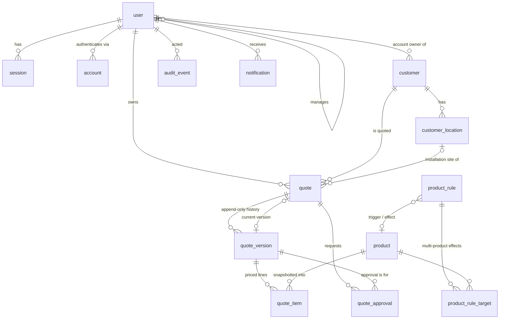

# Database

PostgreSQL, accessed through **Prisma 7** from `@nexora/db`. The schema is
`packages/db/prisma/schema.prisma`; migrations are in
`packages/db/prisma/migrations`.

---

## Model



| Table | Purpose |
|---|---|
| `user`, `session`, `account`, `verification` | Better Auth's tables, extended with `role`, `jobTitle`, `managerId` (team hierarchy) and `isActive`. |
| `customer` | A company. `vatNumber` is unique; `accountOwnerId` is the responsible salesperson. |
| `customer_location` | An installation site: address, site contact, **serviceability** and the maximum bandwidth deliverable there. |
| `product` | The catalogue. Prices in cents, `pricingModel` (per unit / flat / per site), `minContractMonths`, `maxDiscountBps`, `bandwidthMbps` for connectivity. |
| `product_rule`, `product_rule_target` | Compatibility rules as data: a trigger and an effect ([CPQ-RULES.md](CPQ-RULES.md)). The target table holds the product lists of `REQUIRES_ONE_OF` / `AT_MOST_ONE_OF` effects. |
| `quote` | The commercial container: number, status, owner, customer, site, validity, and a pointer to its **current** version. |
| `quote_version` | One priced configuration. Every money column is server-computed. Superseded, never updated or deleted. |
| `quote_item` | A priced line on a version, with SKU and name **snapshots** so a renamed product never rewrites an old quote. |
| `quote_approval` | A request for sign-off, bound to the exact version it concerns, with the requested and allowed discount snapshotted. |
| `audit_event` | Who did what to which entity, with a human-readable summary. |
| `notification` | In-app notifications (approval requested / decided, quote accepted). |

### Enums instead of lookup tables

Roles, product categories, statuses, rule kinds and audit actions are Postgres
enums mirrored by `as const` objects in `@nexora/types`. They are part of the
code's control flow — the state machine, the RBAC matrix and the rule
interpreter switch over them exhaustively — so a row in a lookup table that the
code does not know about would be a bug, not a feature. A test in
`packages/db/prisma/seed-data/seed-data.test.ts` fails if the TypeScript and
Prisma enums drift apart.

### JSON, where it earns its place

Only `quote_version.configSnapshot` and `audit_event.metadata` are JSON.
The snapshot freezes what was evaluated when the version was saved — rule
findings, the discount evaluation and the discounts applied with amounts — so an
old version can be displayed and re-rendered as a document exactly as it was,
even after the rules change. It is a record, not a place where queryable data
hides: everything anything filters or sorts on is a column.

---

## Money

All money is **integer euro cents** (`Int`); all rates are **basis points**
(`1800` = 18%). Floating point never touches a price
([ADR-003](adr/ADR-003-integer-cents-and-basis-points.md)). Monthly totals,
setup totals, MRR, OTC and TCV are stored on the version rather than recomputed
on read, because a quote is a commercial record: it must show what was offered,
not what today's catalogue would produce. Document generation re-checks that
the stored figures are internally consistent before rendering them.

---

## Integrity rules enforced by the schema

- `quote.quoteNumber`, `customer.vatNumber`, `product.sku`, `user.email` are unique.
- `(quote_id, version_number)` is unique; `quote.currentVersionId` is unique.
- `(quote_version_id, product_id)` is unique — a product appears once per version.
- Deleting a user who owns customers, quotes, versions or approval requests is
  **restricted**; deleting a quote cascades to its versions, items and approvals.
- An approval's decider is `SET NULL` on user deletion, so history survives.

## Indexes

Every index corresponds to a query the application runs:

| Index | Serves |
|---|---|
| `quote (ownerId, status)` | "my quotes in this status" — the rep's list and dashboard |
| `quote (status, updatedAt)` / `quote (updatedAt)` | status-filtered and default-sorted quote lists |
| `customer (companyName)` | the customer list's default ordering |
| `quote_approval (decision, createdAt)` | the approval queue, oldest first |
| `audit_event (entity, entityId, createdAt)` | an entity's history |
| `audit_event (actorId, createdAt)` | a user's activity feed |
| `notification (userId, readAt, createdAt)` | unread notifications badge |
| `product_rule (isActive, priority)` | loading the active rule set in evaluation order |

---

## Connections and drivers

`packages/db/src/client.ts` picks the driver adapter from the connection string:

- a `*.neon.tech` host → `@prisma/adapter-neon` (WebSocket-based, suited to
  serverless functions);
- anything else → `@prisma/adapter-pg` (node-postgres), used by CI's PostgreSQL
  service container and local databases.

Two URLs are configured, and they are genuinely different on Neon:

| Variable | Used by | Neon endpoint |
|---|---|---|
| `DATABASE_URL` | the running apps | pooled (`-pooler` host) |
| `DIRECT_DATABASE_URL` | Prisma Migrate (via `prisma.config.ts`) | direct — migrations need session-level advisory locks a transaction pooler drops |

The client is cached on `globalThis` in development so hot reload does not open
a new pool on every change.

---

## Migrations

```bash
pnpm db:migrate        # prisma migrate deploy — apply committed migrations
pnpm --filter @nexora/db migrate:dev   # create a migration during development
```

The demo database is shared by local development and production, so schema
changes to it follow a stricter path than `migrate dev`:

1. `prisma migrate dev --create-only --name <change>` — generate SQL without applying it.
2. **Read the SQL.** Additive changes (new table, new column with a default, new
   enum value) are safe for the running deployment; anything destructive needs a
   multi-step expand/contract migration.
3. `prisma migrate deploy` — apply.

Every migration so far is additive: the initial schema, then two
`ALTER TYPE … ADD VALUE` changes (`PROFILE_UPDATED` audit action, `WITHDRAWN`
approval decision).

---

## Seed

```bash
pnpm db:seed           # wipe and reseed (deterministic)
pnpm --filter @nexora/db seed:verify   # assert the showcase scenario is intact
```

The seed is deterministic — fixed reference date, seeded random generator — so
every run produces the same data, which is what lets end-to-end tests reseed
before each test and assert on specific quotes.

It creates 6 users across all four roles with a manager hierarchy, 32 products,
18 rules, 10 customers with 20 locations, and 11 quotes covering every status.
Every seeded quote is priced **through the real engine**, not with hand-typed
totals, so the seed doubles as a consistency check on the pricing code.

The flagship scenario is **QT-10482**: ACME GmbH, Munich HQ, 10 Gbps fibre with
SD-WAN, security and enterprise routing on a 36-month term, with three versions
at 8%, 12% and 18% discount and a pending approval on the third, because 18% is
above a sales rep's 10% authority.

All seeded accounts use the password `NexoraDemo123!`, which is published on the
sign-in page. That is acceptable only because every account and record is
fictional; see [SECURITY.md](SECURITY.md#demo-credentials).
