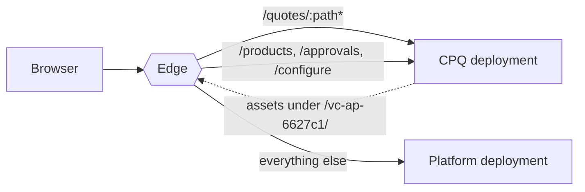

# Micro frontends

Nexora is split into exactly two micro frontends — not six. The split follows a
real ownership line: **who a customer is** versus **what we are selling them**.

| Zone                       | Project                             | Owns                                                                                                 | Writes                                                             |
| -------------------------- | ----------------------------------- | ---------------------------------------------------------------------------------------------------- | ------------------------------------------------------------------ |
| **Platform** (default app) | `apps/platform` → `nexora-platform` | sign-in and sessions, dashboard, customers and locations, activity, profile, settings                | users' own profile, customers, locations, audit for those          |
| **CPQ**                    | `apps/cpq` → `nexora-cpq`           | product catalogue, configurator, pricing, approvals, quotes, versions, quote documents, quote emails | quotes, versions, items, approvals, notifications, audit for those |

Both read customers (CPQ needs them to raise a quote); only Platform writes
them. Both read users and sessions; only Platform's auth routes create them.

---

## Composition: one origin, two deployments

The zones are composed with **Vercel Microfrontends** (multi-zone routing at the
edge), not client-side module federation ([ADR-001](adr/ADR-001-two-mfes-with-vercel-microfrontends.md)).
Routing is declared once, in `apps/platform/microfrontends.json` (Platform is
the default app, so it owns the file; `apps/cpq/microfrontends.json` is kept
identical so each app can be built and run on its own):

```jsonc
"nexora-cpq": {
  "routing": [{
    "paths": ["/quotes", "/quotes/:path*", "/configure", "/configure/:path*",
              "/products", "/products/:path*", "/approvals", "/approvals/:path*"]
  }]
}
```

Everything not listed goes to Platform — including `/api/*`. That has a
practical consequence worth remembering: **a CPQ route handler must live under a
CPQ-owned path.** The document, progress-stream and current-version endpoints
are therefore at `/quotes/:id/document`, `/quotes/:id/document/generate` and
`/quotes/:id/current-version`, not under `/api`. (An earlier version put one
under `/api/quotes/...`; it worked on CPQ's own domain and 404'd through the
edge.)



CPQ's static assets are served under a generated prefix (`/vc-ap-…`) so that
two Next.js builds can share one origin without their `/_next/` paths colliding.
`withMicrofrontends()` in each `next.config.ts` sets this up.

### Locally

`pnpm dev` starts Platform on **3000**, CPQ on **3001** and the microfrontends
proxy on **3024**. Browse **http://localhost:3024**. Visiting 3000 or 3001
directly works for a single zone, but links into the other zone will 404 because
nothing is routing them.

---

## Making two apps feel like one

- **One shell, two copies.** The sidebar, top bar and theme live in
  `@nexora/ui/shell`. Each app renders it with `zone` set, and
  `buildNavItems({ zone })` marks which links leave the current zone.
- **Cross-zone links are plain `<a>`.** `next/link` does client-side navigation
  inside one Next.js app; used across zones it tries to fetch a route the current
  app does not have. Links into the other zone — including the profile and
  settings links in CPQ's top bar — are full navigations.
- **Session is shared by construction.** Both zones are the same origin, so the
  Better Auth cookie issued by Platform is sent with every CPQ request. CPQ
  validates it against the shared session table; it never handles credentials.
- **The auth client is same-origin.** `@nexora/auth/client` has no `baseURL`.
  Hard-coding Platform's own URL breaks the moment a page is served from the
  proxy's origin (CORS), which is exactly what happened before this rule existed.
- **Trusted origins include the public origin.** Better Auth rejects requests
  whose `Origin` is not trusted (HTTP 403). `AUTH_TRUSTED_ORIGINS` must list the
  edge's origin — `http://localhost:3024` locally, the production domain in Vercel.
- **Theme follows you.** The theme preference is in `localStorage`, which is
  per-origin — shared by both zones — and applied by an inline script before
  first paint, so moving between zones never flashes the wrong theme.
- **Redirects are relative.** CPQ's `requirePagePermission` redirects to
  `/forbidden`, a Platform page; the edge routes it.

---

## Rules for working across the boundary

1. **Never import from the other app.** Shared behaviour goes in a package.
2. **Never write the other zone's tables.** CPQ reads customers; it does not
   create or edit them.
3. **Route handlers live under the zone's own paths** (see above).
4. **Server actions are zone-local.** A form in Platform cannot call a CPQ
   action; it links to the CPQ page instead.
5. **Shared UI must not depend on app routing.** `@nexora/ui` components take
   plain `href`s; they never import `next/link` for cross-zone destinations.

---

## Independent deployment

Each Vercel project uses `turbo-ignore` as its Ignored Build Step, so a commit
that only touches `apps/cpq` (and packages Platform does not depend on) skips the
Platform build, and vice versa. A shared package change rebuilds both.

Failure isolation is real but coarse: if the CPQ deployment is broken, CPQ routes
fail while sign-in, the dashboard and customers keep working, because they are
served by a different deployment.
