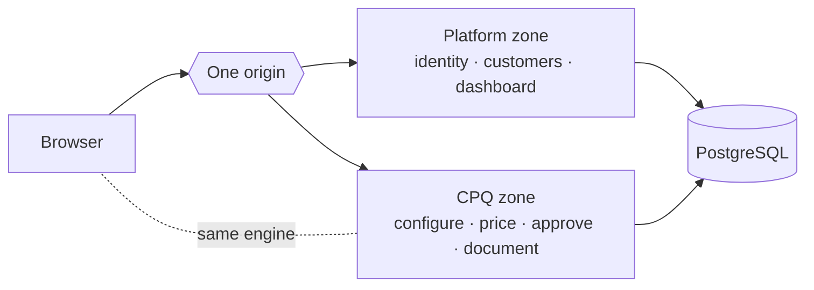

# Case study — Nexora CPQ

_A portfolio project. Nexora Telecom is fictional; no part of this system was
built for, or deployed at, any real company._

---

## The problem

Selling connectivity to businesses is not a shopping cart. A 10 Gbps circuit
needs a particular router, a site that can actually receive it, and a minimum
term. SD-WAN replaces the router it would otherwise need. Discounts depend on who
is asking and on the value of the contract, and above a certain point somebody
else has to sign off. The customer then receives a document that has to be
right, and it has to stay right after the quote is revised.

Configure-Price-Quote systems exist to encode exactly that. They are also where
enterprise software most often fails quietly: prices computed in the browser,
approval rules checked in the UI and nowhere else, histories overwritten.

**The goal** was to build one where those failure modes are designed out, and
where the design is visible in the code rather than asserted in a README.

## What was built

- A **ten-step configurator** with live validation against 18 data-driven rules,
  explanations written for salespeople, and one-click remedies.
- **Pricing and discount engines** that run instantly in the browser and
  authoritatively on the server — the same code in both places.
- A **quote lifecycle** with review, escalation by discount authority and contract
  value, rejection with reasons, withdrawal, revival and cancellation.
- **Append-only versioning** with restore-as-new-version.
- **Customer-grade PDF quotations**, generated on demand with live progress, and
  signed, expiring, version-bound links for customers.
- **Transactional email** that works with no credentials at all, plus in-app
  notifications that can actually be read and cleared.
- **Customer and site management**, including serviceability, which is what the
  configurator's rules are evaluated against.
- **Catalogue and rule administration** for pricing administrators: products,
  prices and discount ceilings, and a rule editor that previews each rule as the
  sentence a sales rep will read.
- **Two independently deployed micro frontends** that behave as one product.
- A **test suite in three layers**, CI, and documentation of the decisions.

Live demo: sign in as the sales rep and open QT-10482, then as the sales manager
to approve it (accounts are listed on the sign-in page).

---

## Architecture in brief

Two Next.js applications, deployed as separate Vercel projects from one
repository, composed at the edge. Shared code lives in nine workspace packages;
the most important is a pure rule-and-pricing engine with no dependencies, which
is what allows it to run in both places. Full detail: [ARCHITECTURE.md](ARCHITECTURE.md).

---

## Decisions that shaped it

**The browser cannot send money.** The configurator previews prices instantly,
but a save carries only product ids, quantities, a term and a _requested_
discount. The server reloads the catalogue, re-evaluates the rules, clamps the
discount to policy and prices from database rows. A test posts fabricated totals
and asserts they are ignored. ([ADR-004](adr/ADR-004-server-authoritative-pricing.md))

**Rules are data.** Each compatibility rule is a trigger and an effect in a
table, interpreted by one function. Adding a rule is an insert. The vocabulary is
deliberately closed and exhaustively type-checked, trading unlimited flexibility
for rules that can be reasoned about and tested. ([ADR-005](adr/ADR-005-rules-as-data.md))

**Authorization lives in queries.** Which quotes a user may see is compiled into
the `WHERE` clause, and a quote they may not see is reported as _not found_, so
guessing ids reveals nothing. ([SECURITY.md](SECURITY.md))

**History is never rewritten.** Every save is a new version; approvals and
customer links are bound to versions. ([ADR-007](adr/ADR-007-append-only-versioning.md))

**Two micro frontends, not six.** The split follows a genuine ownership line —
who the customer is, versus what is being sold to them — rather than one
deployment per screen. ([ADR-001](adr/ADR-001-two-mfes-with-vercel-microfrontends.md))

---

## What went wrong, and what it taught

The most useful part of the project was the defects found by building the
verification layers, not the features themselves.

1. **Per-bundle discount capping.** The first pricing engine capped the whole
   quote at its least flexible product's maximum discount. Two versions of the
   flagship quote at different discounts produced identical totals — and almost
   any quote containing hardware became impossible to discount. Rewriting to
   per-line ceilings came with a regression test named for the bug.

2. **Workflow bugs hiding behind the UI.** Moving the quote workflow out of
   server actions into testable services, and then writing integration tests
   against a real database, surfaced four defects in an afternoon: "send for
   approval" was refused by the state machine; a manager could approve a discount
   above their own authority; withdrawing a quote left its approval request
   pending forever; and a discount beyond anyone's authority was stored
   unclamped. The tests were then checked by deliberately removing a guard and
   watching them fail. ([ADR-011](adr/ADR-011-services-behind-thin-actions.md))

3. **A route that worked everywhere except production.** An API route inside the
   CPQ app worked on CPQ's own domain but returned 404 for real users, because the
   edge routed `/api/*` to the other zone. The lesson became a documented rule:
   route handlers live under the zone's own paths. ([MFE.md](MFE.md))

4. **A specification that could not be satisfied.** Two requirements, read
   literally, made every 10 Gbps configuration invalid. Resolving it meant
   deciding what the rule was _for_ and recording the interpretation.

5. **Authentication across an origin boundary.** The auth client initially
   pointed at the Platform app's own URL, which broke with CORS errors the
   moment pages were served through the shared origin, and then with 403s until
   the public origin was trusted.

---

## Quality

- **Unit tests** across the engine, auth, validation, email, observability, seed
  integrity and app helpers, with enforced coverage thresholds on the engine.
- **Integration tests** of the quote workflow and document generation against
  PostgreSQL.
- **End-to-end tests** through the real micro-frontend composition: the quote
  journey, approval, access control, invalid configurations, revisions and
  notifications. The journey test found two form defects on its first run.
- **CI** runs lint, type-checking, all three test layers and a secret scan.
- Harnesses refuse to run against the live demo database.

See [TESTING.md](TESTING.md).

---

## Trade-offs, stated plainly

- Email is at-most-once; a transactional outbox would need a scheduler outside
  free-tier limits. ([ADR-010](adr/ADR-010-email-after-commit.md))
- Documents are re-rendered on every open instead of cached.
- No MFA, password reset or Content-Security-Policy — out of scope for a demo
  with public, fictional accounts.
- Discount authority limits and the contract-value threshold are policy in code
  (`cpq-engine/policy.ts`), not editable rows. Products and rules _are_ editable
  in the app; the thresholds that govern approval deliberately are not, because
  changing them is a change to the commercial model, not to data.
- Navigation between zones is a full page load, the accepted cost of keeping
  each zone an ordinary server-rendered application.

---

## Stack

Next.js 16 · React 19 · TypeScript (strict) · Tailwind CSS 4 · Radix primitives ·
React Hook Form · Zod 4 · PostgreSQL (Neon) · Prisma 7 · Better Auth ·
@react-pdf/renderer · Vitest · Playwright · pnpm · Turborepo · Vercel
Microfrontends · GitHub Actions.
